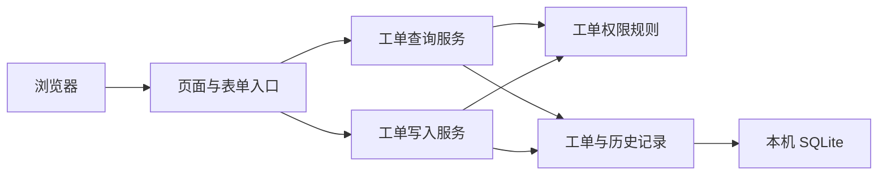

# 实验室报修跟踪 · 架构约束

以下规则是第一版设计提案。需求来源和候选方案记录见[架构方案与 ADR](architecture.md)。

## Design Paradigm

服务端渲染的分层单体。浏览器用页面和表单与应用交互。页面入口调用工单查询和写入服务。工单服务使用统一权限规则与持久化层。

## Invariants & Rules

### AD-1 — 单个 Web 应用和清晰的写入边界

- **Binds:** FR-1 至 FR-9。
- **Prevents:** 页面、管理入口和工单功能分别实现状态变更。
- **Rule:** 页面负责解析表单和展示。新建、接单、进度、提交验收、关闭和退回均经工单写入服务。工单读取经统一查询服务。

### AD-2 — 单机数据库与短写事务

- **Binds:** NFR-1、M2 并发验收。
- **Prevents:** 每个进程各持一份工单数据，或写入争用导致状态和历史分裂。
- **Rule:** 演示实例的应用进程共用同一主机上的 SQLite 文件。写入服务在显式的短事务中使用 `IMMEDIATE` 模式。锁等待超时按暂时不可用返回，和状态版本冲突分开处理。事务外完成页面渲染。

### AD-3 — 状态和版本共同约束写入

- **Binds:** FR-5 至 FR-9、NFR-1。
- **Prevents:** 并发关闭和退回同时成功，或上一轮验收页面操作了下一轮。
- **Rule:** 已存在工单的写入须携带页面读取的版本。写入服务在事务中检查身份、归属及动作允许的状态，再按工单编号、预期版本和预期状态执行条件更新。成功时版本加一，进度更新也一样。更新影响零条记录时拒绝写入并提示刷新。退回沿用原工单和原负责人。状态转换以 PRD 为准。

### AD-4 — 服务端统一执行对象权限

- **Binds:** FR-1 至 FR-9、NFR-2。
- **Prevents:** 用户通过修改页面参数或直接请求绕过界面权限。
- **Rule:** 使用 Django 会话中的已登录用户标识。服务器根据负责人组、报修人、跟进人及状态判定资格。列表和详情使用同一套可见性规则。成员可查自己提交的单。负责人还可查待接单和自己接下的单。当前跟进人能更新进度及提交验收，只有该单报修人能确认关闭或退回。

### AD-5 — 工单与历史记录一起提交

- **Binds:** FR-4、FR-6 至 FR-9、NFR-1。
- **Prevents:** 覆盖上轮处理结果或留下与工单状态矛盾的记录。
- **Rule:** 工单保存当前状态、跟进人、版本和最近更新时间。每次成功写入追加一条关联工单的事件，记录工单版本、操作者、动作及服务端时间。进度、处理结果和退回原因随各自事件保存。工单更新和事件写入同事务成功或回滚。详情按工单版本排序，最新进度从最近的进度事件读取。

## Stack

| Name | Version |
| --- | --- |
| Python | 3.12，候选版本系列 |
| Django | 5.2 LTS，候选版本系列 |
| SQLite | 3.49.1，本机 Python 实测版本 |

## Structural Seed

演示采用一台机器、一个应用和一个本地持久化数据文件。以 Django 官方 `startproject` 骨架为起点，服务端模板、页面入口与工单服务同仓库。用文件数据库、独立连接执行并发集成测试。由 README 固化初始化、演示账号配置和启动步骤。

## Deferred

- 精确依赖版本、评审机运行环境和账号初始化命令在建立项目骨架时锁定。
- 公网部署和跨实验室运行留待有相应需求时设计。若课堂目标环境的锁争用测试失败，重新比较数据库方案。
